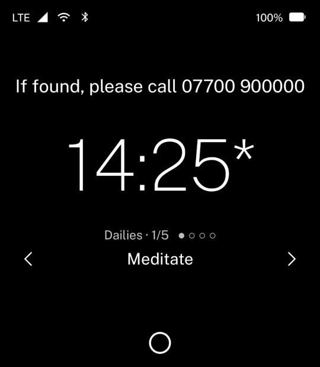
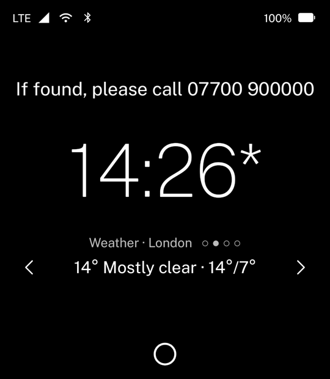
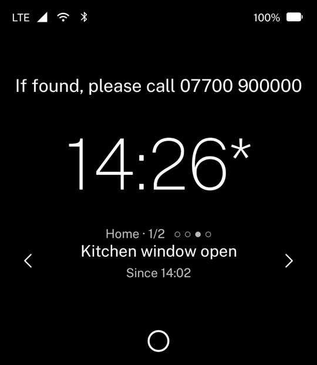
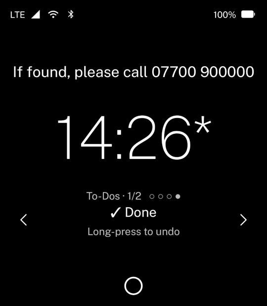
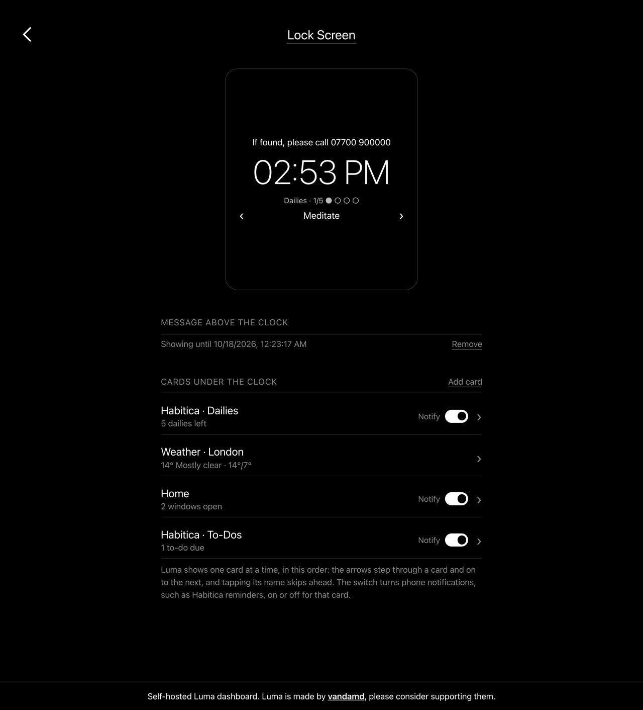
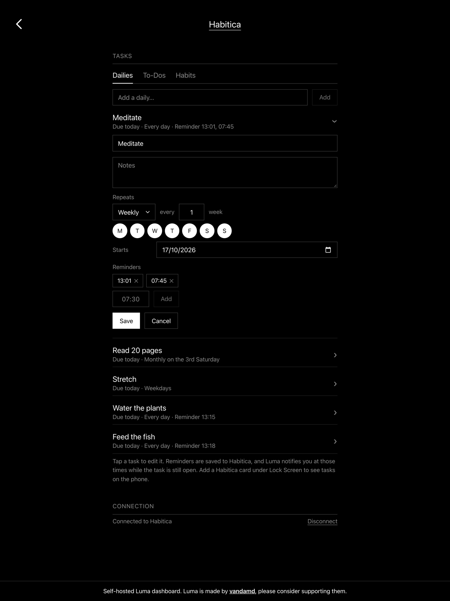

<h1 align="center">Luma Dashboard</h1>

<p align="center">
  A self-hosted dashboard for <a href="https://github.com/vandamd/luma">Luma</a>, the Light Phone III launcher.<br>
  Pick your tools and apps, put a message on the lock screen, and add live cards under the clock.
</p>

<p align="center">
  <a href="https://railway.com/deploy/light-phone-luma-dashboard?referralCode=cI6oNd"></a><br>
  <sub>Affiliate link</sub>
</p>

<p align="center">
  
  
  
  
</p>

Luma and its hosted dashboard, [dashboard.noscroll.ing](https://dashboard.noscroll.ing), are made by
**[vandamd](https://github.com/vandamd)**. This project is an independent, self-hostable version of that
dashboard, built by working out how Luma talks to it. If you use Luma, please consider supporting vandamd.

## Features

- **Tools and apps.** Choose and order the home screen, and install apps from a merged App Store
  ([Bright Market](https://github.com/gi-os/brightmarket-index),
  [awesome-light](https://github.com/garado/awesome-light) and vandamd's own apps).
- **Lock screen message.** A line above the clock, such as "If found, please call…".
- **Lock screen cards.** Up to five cards under the clock that you can page through on the phone:
  weather, a webhook you can send anything to, and Habitica.
- **Habitica.** Your dailies, To-Dos, habits or stats on the lock screen. Long-press a task to
  complete it, manage tasks, schedules and reminder times from the dashboard, and get reminders as
  phone notifications.
- **Real time.** Changes reach the phone within seconds over Luma's existing sync connection.
- **Private by design.** Accounts are anonymous 16-digit numbers, the login captcha is
  proof-of-work with no third party, and integration credentials are encrypted at rest.

<p align="center">
  
  
</p>

## Requirements

- A Luma build with the **Server** setting on its login screen. It is not in upstream Luma yet.
- For Habitica webhooks and safe use over the internet, an `https://` address.

## Deploy

### Railway

Click **Deploy on Railway** above. The template sets everything up, including the secret. When it
finishes, open the `web` service's URL, create an account, and enter the same URL under **Server**
on Luma's login screen. Railway charges for usage; expect a few dollars a month.

> [!NOTE]
> The Railway button is an affiliate link. If you deploy through it, this project gets a share of
> what you spend on Railway, at no extra cost to you.

### Docker Compose

On any machine with Docker:

```sh
mkdir luma-dashboard && cd luma-dashboard
curl -fsSLO https://raw.githubusercontent.com/vbbot/luma-dashboard/main/docker-compose.yml
curl -fsSL -o .env https://raw.githubusercontent.com/vbbot/luma-dashboard/main/.env.example
```

Set two values in `.env`:

| Setting | Value |
|---|---|
| `PUBLIC_URL` | Where the dashboard is reached, and what you enter under **Server** in Luma. E.g. `https://luma.example.com`, or `http://192.168.1.20:8080` on a home network. |
| `INSTANCE_SECRET` | `openssl rand -hex 32`. It must be 64 hex characters. Keep it private and never change it once there is data. |

```sh
docker compose up -d
```

The dashboard listens on port `8080`. To reach it from the internet, put it behind an HTTPS reverse
proxy with WebSockets enabled. To update, run `docker compose pull && docker compose up -d`.

See [Self-hosting](docs/self-hosting.md) for what is exposed, the admin UI, pinning versions and
building the images yourself.

## Documentation

| | |
|---|---|
| [Self-hosting](docs/self-hosting.md) | Railway, Docker, exposure, admin UI, updates, images |
| [Lock screen integrations](docs/integrations.md) | Weather, webhooks, Habitica, and adding new integrations |
| [Card format](docs/lockscreen-cards.md) | The lock screen card format and its limits |
| [App Store](docs/app-store.md) | Where apps come from and how the catalog is built |
| [Luma protocol](docs/protocol.md) | The functions Luma calls and what they return |
| [Development](docs/development.md) | Running the backend and frontend locally |

## How it works

The backend is the open-source [Convex backend](https://github.com/get-convex/convex-backend),
running the functions in [`convex/`](convex). Luma already speaks the Convex protocol, so the phone
connects to it directly. The frontend is a static React app served by nginx, which proxies only the
sync connection and the webhooks to the backend.

## Credits

- [vandamd](https://github.com/vandamd) for Luma and the original dashboard this is modelled on.
- [Convex](https://github.com/get-convex/convex-backend) for the backend,
  [ALTCHA](https://altcha.org) for the captcha, and [Open-Meteo](https://open-meteo.com) for weather.
- [Bright Market](https://github.com/gi-os/brightmarket-index) and
  [awesome-light](https://github.com/garado/awesome-light) for the App Store listings.

Not affiliated with Light or Habitica.
